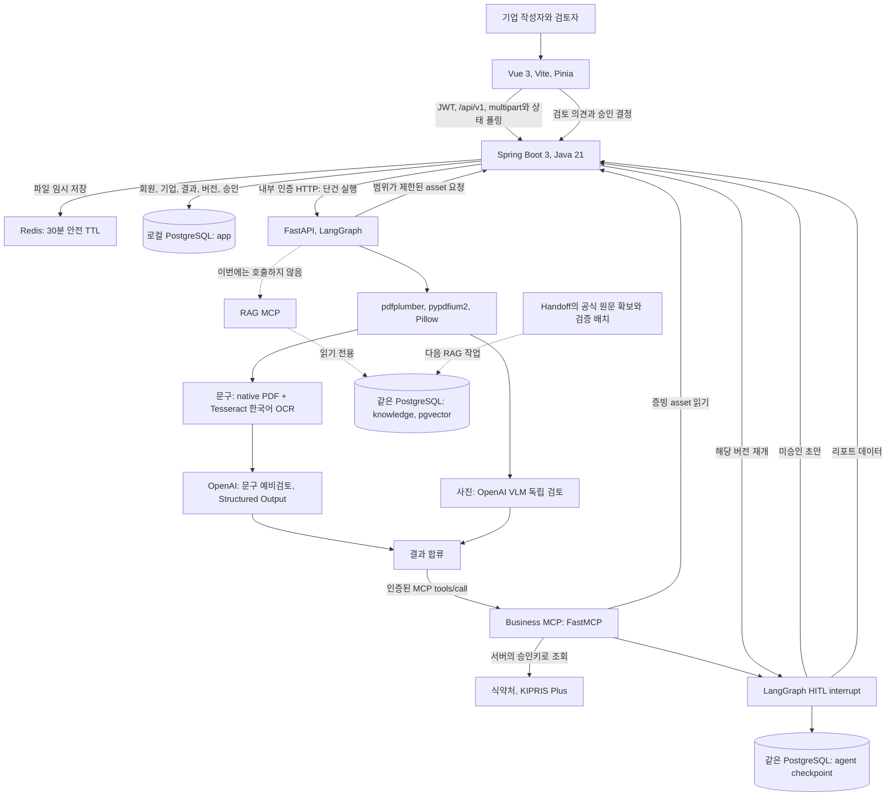

# 서비스 아키텍처

기준은 [노션 기획서](https://app.notion.com/p/Agent-3fe616ab8fec80bfb92df115c66aa83d)와 연결된 MCP, REST, Graph 및 RabbitMQ 문서다.
이번 구현은 제공된 Vue 화면을 연결한 단건 MVP다. RAG DB 계획은 `Cosmetic_RAG_AI_Handoff`를 반영한다.
이 문서는 현재 동작과 최종 목표를 구분한다. 팀원의 통합 기준은 두 저장소의 main이며 기능별 feat 브랜치와 PR로 작업한다.

## 현재 실행 구조

pgvector는 PostgreSQL의 확장이다. 별도 벡터 서버나 클라우드 계정을 만들지 않는다.
하나의 로컬 DB 서버 안에서 app, agent, knowledge 스키마와 DB 사용자를 분리한다.
과금 원장은 목표상 별도 서비스와 DB이며 현재 실행 구조에 넣지 않았다.

## 서비스 분할과 기술

| 서비스 | 현재 책임과 코드 | 주요 기술 | 다음 작업 |
| --- | --- | --- | --- |
| Frontend | 로그인, PDF와 이미지 선택, 진행, 원문과 사진 결과, 승인, 이력, 출처 목록 | Vue 3, Vite, Pinia, Router | 정밀 위치 UX, API 항목 재조회, 팀원 관리 UI |
| Backend | 기업 권한, JWT 세션, 업로드, 결과와 광고 버전, 결정 저장, 원본 폐기 | Spring Boot 3, Security, JDBC, Flyway, Redis | SSE, 내구성 있는 작업 발행, 도메인 테이블 정규화 |
| Agent | 광고 파싱, 두 분석 경로, 조건부 Business MCP 호출, HITL | FastAPI, LangGraph, OpenAI Responses, Pydantic, PostgreSQL checkpointer | 근거 검색과 검증 루프, API 사용량 계측, 제한 재시도 확장 |
| Business MCP | 증빙 문자 추출, 식약처 품목 조회 adapter, KIPRIS 등록 후보 조회 | FastMCP, httpx, 공통 파서 | 증빙 의미 구조화와 제품 주장 대조, 청구항 원문 확보와 대조 |
| RAG MCP | 연결 가능한 기존 v0.1 검색 stub | FastMCP, psycopg | Handoff 원문 수집과 검색, 최신 2개 도구 계약 전환 |
| Data | app, agent와 빈 knowledge, 원본 임시 캐시 | PostgreSQL 17, pgvector, Redis | 공개 코퍼스 적재와 검색 평가 |

Agent API와 Worker는 노션의 한 Agent 서비스 안의 역할이다. 입력 처리를 위한 세 번째 MCP나 새 Worker 배포 서비스를 추가하지 않는다.
업무 DB는 Backend가 소유한다. Business MCP는 Backend 내부 API를 사용하고 DB나 Redis에 직접 연결하지 않는다.
Agent의 DB 직접 접근은 agent checkpointer만 허용한다.

## 입력부터 결과까지

1. 기업 작업공간을 생성하거나 로그인한다. 최초 계정은 해당 기업 관리자이며 다른 기업 자료 접근은 서버에서 차단한다.
2. 제품정보와 광고 파일을 제출한다. 광고 입력은 PDF와 이미지 두 종류이고 증빙 파일은 별도 역할로 선택 제출한다.
3. Backend가 실제 파일 서명과 크기를 확인하고 asset 메타데이터 및 SHA-256, 버전을 app에 저장한다. 원본 바이트는 Redis에 임시 보관한다.
4. 접수 트랜잭션을 저장한 뒤 202와 review 객체를 반환한다. 제한된 API 실행 풀이 Agent를 호출하며 Vue는 상태를 폴링한다.
5. Agent가 실행별 토큰으로 해당 버전의 광고만 읽는다. PDF native 문자와 페이지 렌더, 긴 이미지 타일을 준비한다.
6. 문구는 PDF 파싱과 OCR 후 LLM으로 확인할 주장 후보를 만든다. 사진은 별도 VLM 호출로 비교 표현과 조명 및 각도 등 관찰 한계를 기록한다.
7. 두 결과가 합류한다. 증빙이 있으면 structure_evidence, 보고번호가 있으면 verify_functional_approval, 광고나 증빙에 특허 후보가 있으면 verify_patent를 호출한다. 도구 오류는 항목별로 분리한다.
8. Graph는 초안과 사람 확인 대기를 PostgreSQL checkpoint에 저장하고 실행 요청을 종료한다. Backend가 초안을 app에 보존하고 원본을 Redis에서 삭제한다.
9. 검토자 또는 관리자가 최신 버전의 의견과 결정을 저장한다. Backend는 먼저 결정을 보존하고 해당 Graph를 재개한다.
10. 결과와 이력을 다시 조회하고 브라우저 인쇄로 PDF 저장 또는 HTML 내보내기를 한다. 서버가 PDF 바이너리를 생성하는 기능은 아직 없다.

처리 완료는 AI 추론이나 법령 적합성 확인 완료와 다르다. 모델 키가 없으면 native PDF와 로컬 OCR은 수행해도 문구 모델과 사진 모델은 `not_configured`다.
RAG를 호출하지 않으므로 `retrievalStatus=not_connected`, `legalStatus=not_evaluated`를 유지하고 인용 조항이나 적합 점수를 만들지 않는다.
사진은 실제 효능, 보정 여부와 동일 인물을 확정하지 않는다. 사진 결과를 억지로 텍스트 RAG 결과로 바꾸지 않는다.

## 수명과 실패 처리

- 원본은 처리 종료 시 삭제하고 30분 TTL은 비정상 종료의 안전장치로 둔다. 결과와 파생 텍스트는 별도 정책으로 DB에 보관한다.
- 원본 이미지와 요청 토큰은 closure와 내부 요청에만 두고 Graph checkpoint나 공개 결과에 넣지 않는다.
- 같은 브라우저의 선택한 File은 임시 미리보기가 가능하지만 새로고침하거나 다른 기기에서 열면 원본이 없다. 같은 파일 재열람 기능은 후속이다.
- 파일이 손상됐거나 지원하지 않는 형식이면 접수 또는 파싱 단계에서 실패한다. 실패한 작업은 새 원본을 제출한다.
- 모델과 공공 API 오류는 적합 판정으로 바꾸지 않는다. 정상 조회 결과 없음과 API 설정 또는 연결 실패를 구분한다.
- 승인 결정은 저장됐지만 Agent 재개에 실패하면 `approval.agentResume=pending`을 보존한다. 자동 재개 재시도는 후속이다.
- 삭제는 실행 중인 작업을 막고 체크포인트부터 삭제한 뒤 app 이력과 asset 메타데이터를 삭제한다.

## 노션 목표와 현재 MVP의 차이

| 목표 | 현재 |
| --- | --- |
| 단건 즉시 응답과 SSE | 접수 후 202, 인증된 1.5초 상태 폴링 |
| 다건 Backend → Agent API → RabbitMQ → 내부 Worker | RabbitMQ 선택 프로필만 제공, 업무 발행과 Worker 없음 |
| 한도 있는 Agent 도구선택 loop | 문구와 사진 분리 및 입력 조건에 따른 3개 Business 도구 호출 |
| search_regulations, search_precedents | Handoff DB 계획과 출처 목록만 반영, 실제 수집과 검색 없음 |
| 증빙 및 제품 주장 대조와 특허 청구항 대조 | 증빙 문자 추출과 조회 adapter까지만 구현 |
| 사용량 이벤트와 별도 과금 원장 | 과금 비활성, 크레딧 0은 무료 서비스 보장이 아닌 미구현 표시 |
| 서버 리포트 PDF | 브라우저 인쇄와 HTML 내보내기 |

현재 실행 풀은 프로세스 재시작 후 대기 작업을 복구하지 않는다. 운영용 durable queue나 자동 장애 복구 구현으로 설명하지 않는다.
다건의 목표는 접수 기록 저장 후 202, 승인 대기 checkpoint 저장 후 ACK, 승인 결정 저장 후 별도 재개 메시지다.
업무 메시지에는 원본 바이트를 넣지 않으며 publisher confirm, 수동 ACK, 멱등키와 DLQ를 함께 구현해야 한다.

## RAG 담당의 다음 연결

공개 PDF와 법제처 API 원문을 검증하고 knowledge에 미리 색인한다. 제품 및 특허 조회 API는 Business MCP 실시간 경로로 남긴다.
S01~S09와 미확인 개정일은 출처 후보이며 이번에 수집한 법률 자료가 아니다.
자세한 표와 단계는 [데이터 계획](04-data.md), [RAG 시작점](06-rag-start.md), 실제 입출력은 [공통 계약](03-contracts.md)에 있다.

## 노션 ERD v2 연결

[최신 ERD](https://app.notion.com/p/Data-ERD-App-State-Vector-DB-3ff616ab8fec81c7b57ac75358ced570)는 주요 DB 한 개의 app/state/vector 분리와 별도 과금 DB를 명시한다.
현재 물리 스키마 app/agent/knowledge와 목표 테이블의 대응은 [데이터 모델](04-data.md)에 있다.
RAG의 knowledge는 Handoff 기준을 유지하고 Agent의 광고 파싱과 Business MCP의 증빙 처리를 섞지 않는다.
키가 없으면 모델과 공식 API를 실행한 것으로 표시하지 않는다. 원문 수집 및 기본 청킹 점검은 검색 색인과 분리한다.
