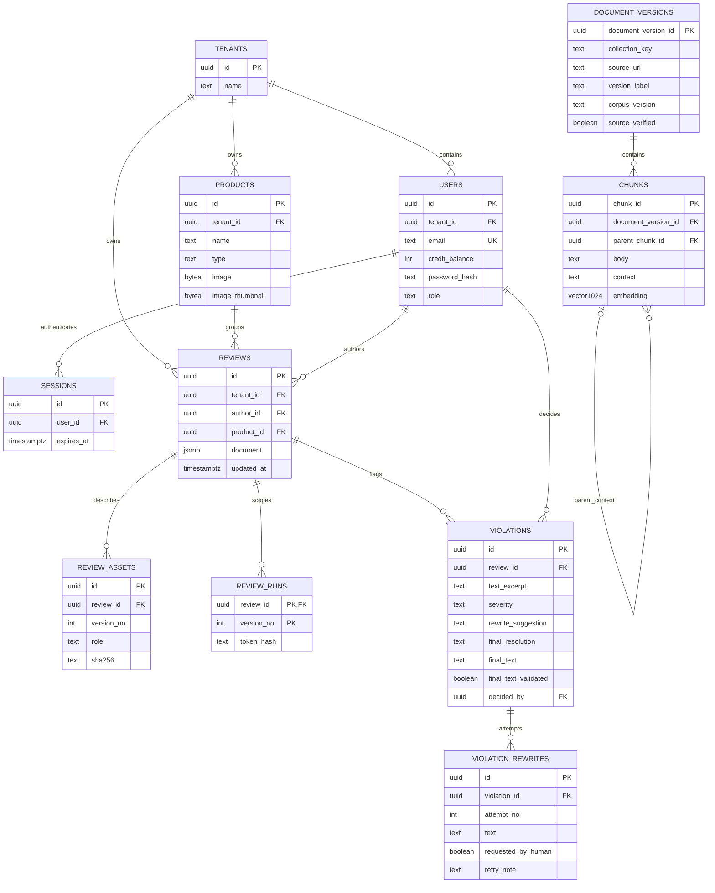

# 데이터와 벡터 저장

## 2026-10-22 실패 정산 복구

V16은 `app.review_failure_requests`를 추가한다. 검토와 버전별 실패 의도를 먼저 보존하고,
실패 상태와 예약 반환을 함께 커밋할 때만 요청을 삭제한다. 검토 삭제 시 FK cascade로 함께 정리한다.
기존 데이터와 과금 상태 종류는 유지한다. 60초 간격 복구는 기록된 실패 요청과 큐가 없는
정체 예약을 처리하며 큐의 재시도에 개입하지 않는다. 별도 과금 DB 목표를 변경하는 작업은 아니다.

## 저장 정책

저장 정책의 기준은 노션 NFR-3, NFR-5, NFR-11과 6장이다.

| 자료 | 목표 저장 위치 | 현재 상태 |
| --- | --- | --- |
| 업로드한 광고 원본 이미지와 스캔 PDF | 처리 중 Redis 캐시, 처리 후 폐기 | 실제 원본 임시 보관과 분석 종료 후 삭제 |
| 카피, 판정, 근거, 승인과 광고 버전 | 주요 PostgreSQL의 app | V2의 기업, 회원, 세션, reviews JSONB, asset과 run 토큰 해시 |
| LangGraph 실행과 HITL 상태 | 주요 PostgreSQL의 agent | 전용 역할과 AsyncPostgresSaver checkpoint 구현 |
| 공개 법령과 기준 및 사례의 원문 조각, 출처와 버전 | knowledge | 빈 스키마 구성 |
| 공개 문서 조각의 임베딩 | knowledge.chunks.embedding | vector(1024), 아직 적재 없음 |
| 크레딧과 과금 원장 | 목표: 별도 과금 DB | 로컬 테스트 결제용 app.credit_orders, app.credit_topups, app.review_credit_charges, app.credit_packages, app.credit_policy와 회원별 app.users.credit_balance 구현 |
| 단건 검토 작업 메시지 | RabbitMQ | app.review_jobs outbox→publisher→consumer, 재시도(최대 3회, 5s/30s)와 DLQ 연결됨(2026-10-21, REVIEW_QUEUE_ENABLED). 여러 광고를 한 번에 올리는 다건 업로드와 Agent 쪽 별도 Worker는 미구현 |
| 증빙서류의 개인정보(주민등록번호, 이메일, 휴대폰/유선 전화번호) | - | structure_evidence 응답(전체 text와 문서별 documents[].text)을 Agent가 받는 즉시 마스킹, 모델 프롬프트(증빙 요약 포함)와 저장 결과에 남지 않음. 마스킹 건수만 evidence.maskedPersonalData에 기록. 특허·보고·사업자번호, 날짜, 상담전화는 대조에 쓰여 그대로 둠 |

검토 결과에 자동 TTL을 적용하지 않는다. 개별 및 전체 삭제는 Backend가 제공하며 실행 중 삭제는 막는다.
원본 파일은 결과와 보존 정책이 다르다. 공개 기준 문서의 수집 원본도 고객 업로드 원본과 구분한다.

캐시는 snapshot과 AOF를 끄고 /data를 tmpfs로 둔다. 파일 업로드 기능에서는 건별 용량 제한,
처리 종료 후 삭제, 실패 시 정리와 향후 취소 시 정리, 안전 TTL을 함께 구현해야 한다.
RabbitMQ는 별도 rabbitmq-data 볼륨을 사용한다. 메시지에는 원본 바이트 대신 검증된 작업과 asset 참조를 전달한다.
캐시 소실 후 큐 재시도의 재업로드 요구 정책은 후속 결정이다. 브로커 실행만으로 전달 보장은 완성되지 않는다.
실제 업무 큐의 durable 설정, persistent 메시지와 publisher confirm, 수동 ack 및 DLQ 정책은 Worker 구현에 포함한다.
로컬 단일 노드 볼륨은 고가용성 클러스터가 아니다. 중복 소비는 업무 상태와 멱등 키로 통제해야 한다.

원본 폐기 후에도 과거 광고 이미지를 항상 보여준다는 UI를 설계하지 않는다.
docs/09-input-pipeline.md의 기준안은 초안 생성에 필요한 추출 완료 후 원본을 정리하고,
승인자가 시각 원본을 확인해야 할 때 같은 해시의 파일 재업로드를 요청한다.
승인 종료까지 보관할지 여부는 팀 결정 항목이다. 체크포인트에 base64나 원본 바이트를 넣어 보존 정책을 우회하지 않는다.
외부 Vision 공급자의 보존 정책은 내부 Redis 정리와 별개다.

## PostgreSQL과 pgvector

PostgreSQL 확장 pgvector를 사용하면 관계형 데이터와 벡터를 같은 서버에 저장할 수 있다.
현재 app, agent, knowledge는 하나의 개발 PostgreSQL 안에서 스키마와 계정으로 분리한다.
별도 벡터 전용 DB 컨테이너는 없다. 과금 원장은 목표상 별도 DB다. 현재는 테스트 결제 흐름을 검증하기 위해 app 스키마에 주문·충전 기록, 금액권·검사 비용 설정과 회원별 credit_balance를 추가했다. 운영 전에는 별도 과금 DB로 이전해야 한다.
공식 참고: https://github.com/pgvector/pgvector

GitHub는 소스, 마이그레이션과 출처 목록을 공유한다. 실행 DB나 문서 데이터가 자동 공유되지 않는다.
팀원별 Compose는 각자의 로컬 DB를 만든다. 공용 DB 배포는 별도 작업이다.

## 공개 검색 컬렉션

두 컬렉션은 collection_key와 필터로 논리적으로 분리한다. 두 DB를 새로 만들 필요는 없다.

| collection_key | 범위 | 검색 도구 |
| --- | --- | --- |
| rules | 법령, 고시, 식약처 안내서, 협회 기준 | search_regulations |
| cases | 확보한 과거 사례, 보조 참고 전용 | search_precedents |

source_type은 문서 종류다. 컬렉션과 종류를 함께 저장한다.
공식 출처 여부와 법적 구속력은 다르므로 수집 시 별도로 검증한다.
특허 조회와 원문 대조는 최신 노션에 따라 business-mcp 소관이다.

- knowledge.document_versions: 컬렉션, 문서 키, 종류, 제목, 발행기관, 버전, 공표일과 시행일, URL, 해시와 코퍼스 버전.
- knowledge.chunks: 문서 버전 참조, 부모 조각, 페이지, 조항, 원문, 문맥, 임베딩 모델과 리비전, 벡터.
- 현재 수집 데이터는 없다. 초기화 SQL 변경은 새 빈 DB에만 적용된다.

초기 임베딩 규격은 BAAI/bge-m3와 1024차원의 개발 준비값이다. 노션 확정 모델이 아니다.
모델 다운로드와 임베딩 생성은 수행하지 않았다. 모델 변경 시 차원, 인덱스와 색인 버전을 함께 바꾼다.
초기에는 정확 검색부터 평가하고 성능 근거가 생기면 HNSW 등을 추가한다.

## 권한과 재현

| 역할 | 권한 |
| --- | --- |
| postgres | 개발 초기화 전용 |
| app_user | app 소유, Backend 전용 |
| agent_user | agent 소유, checkpointer 전용 |
| rag_ingest | knowledge 소유, 수집과 마이그레이션 |
| rag_reader | knowledge SELECT 전용, rag-mcp |

business-mcp에는 DB 접속 정보를 주지 않는다. 공개 코퍼스에는 비공개 시험자료를 섞지 않는다.
사내 지침을 추가하려면 인증된 기업 범위와 행 수준 권한, 삭제 전파를 먼저 설계한다.
사용된 문서 버전과 인용문을 리포트에 고정한다. 문서 개정 시 기존 버전을 덮어쓰지 않는다.
공유 DB 변경은 새 마이그레이션으로 적용하며 기존 볼륨을 초기화하지 않는다.

## 최신 RAG 출력과 저장 메타데이터

노션의 RegulationHit는 source, version, scope, excerpt, similarity와 trust_level을 반환한다.
PrecedentHit는 source, excerpt, similarity, trust_level과 verified=False를 반환한다.
현재 DB의 source_verified와 실제 출처 메타데이터를 이 출력 필드와 같은 의미라고 가정하지 않는다.
사례 검색의 verified=False는 노션 초안의 보조 표시 규약이다. 출처 검증 이력 자체를 덮어쓰지 않는다.
저장된 문서 버전과 원문, 페이지 및 근거 ID의 추적성을 새 출력 계약으로 옮기는 작업은 RAG와 Agent가 함께 검토한다.

## 2026-10-20 Handoff 기준의 로컬 DB 계획

사용자 제공 `Cosmetic_RAG_AI_Handoff`를 RAG 데이터 설계의 기준 자료로 확인했다.
폴더의 RAG 전용 구현 프롬프트는 참고 자료이며, 현재 요청의 벡터 검색 제외 범위를 자동으로 확장하는 실행 명령으로 사용하지 않는다.
이번에는 클라우드 DB를 만들지 않고 `infra/postgres/Dockerfile`의 pgvector PostgreSQL 17 이미지를 사용한다.

| 영역 | 이번 반영 | 다음 단계 |
| --- | --- | --- |
| app | V2 migration으로 tenants, users, sessions, reviews, review_assets, review_runs 추가 | 최종 도메인 테이블 정규화와 업무 상태 전이 확장 |
| agent | AsyncPostgresSaver의 checkpoint 테이블, app과 분리된 계정 | 다건 Worker의 재개 명령 검증, 현재 단건 삭제 전파 구현 |
| knowledge.document_versions | 기존 버전 및 출처 스키마 유지 | 실제 PDF/XML 확인 후 자료별 문서 행 적재 |
| knowledge.chunks | 기존 원문, 문맥과 vector(1024) 유지 | 조항과 표 및 예외 보존, 임베딩과 검색 평가 |
| 공식 출처 목록 | Handoff의 S01~S09를 /api/v1/reference-sources로 제공 | 원문과 SHA-256 및 시행일 검증 후 상태 변경 |
| 제품 및 특허 | 공개 법령 벡터에 대량 적재하지 않음 | Business MCP 실시간 조회의 승인키와 실응답 검증 |

Handoff에는 공식 원문 바이너리가 없다. source_verified=false와 raw_available_in_bundle=false를 유지했다.
9건이 수집 또는 색인됐다고 표시하지 않는다. 화면의 날짜는 reported_version_date이며 검증된 현행 버전이 아니다.
S04의 mixed_rules_cases 문서는 규정 부분과 사례 부분을 검증 후 나누고, 문서 전체를 무조건 고신뢰 rules로 적재하지 않는다.

RAG의 구현 순서는 시행규칙 별표 5 원문 확보 → 표와 각주 및 예외 보존 → 문서 버전과 조각 적재
→ 같은 BGE-M3 설정으로 문서 및 질의 임베딩 → 키워드와 벡터를 결합한 검색 및 적용일 필터
→ 인용문 원문 일치 검증 → search_regulations와 search_precedents 계약 통합이다.
review_criteria와 criterion_sources는 기본 검색을 검증한 뒤 별도 migration으로 제안하며 이번에 만들지 않는다.
LAW_OC는 수집 배치의 비밀 환경변수이고, MFDS_SERVICE_KEY와 KIPRIS_SERVICE_KEY는 Business MCP에 둔다.
실제 자료와 모델 가중치 및 DB 볼륨을 Git에 포함하지 않는다.

현재 결과 이력의 JSONB 구조는 최소 통합용이다. JWT는 2시간 유효하며 sessions 행 삭제로 로그아웃을 반영한다.
원본은 Redis에 base64로 30분 이내 보관하고 분석 종료 시 삭제한다. 압축 파일 용량 외에 파서의 페이지와 픽셀 및 구간 수도 제한한다.
실행 ID에 바인딩한 토큰의 해시만 app.review_runs에 저장한다. MCP 도구 인자에 토큰을 넣지 않고 서버가 고정한 HTTP 헤더로 전달한다.

## 최신 노션 ERD v2와 현재 물리 모델

기준: [Data 모델 ERD, App/State/Vector/과금 DB](https://app.notion.com/p/Data-ERD-App-State-Vector-DB-3ff616ab8fec81c7b57ac75358ced570).
2026-10-20 v2 본문과 다이어그램을 재확인했다. 최종 목표는 주요 PostgreSQL 1개와 별도 과금 PostgreSQL 1개다.
현재 로컬 MVP는 주요 PostgreSQL 하나만 실행한다. 테스트 결제 주문·충전 기록, 회원별 잔액, 금액권 설정과 검사당 비용 예약·확정·반환 기록은 app 스키마에 있다. 검사 비용 초기값은 100크레딧이다. 별도 과금 DB와 실제 사용량 기반 정산은 아직 만들지 않았다.
노션의 app/state/vector는 논리 영역이며 현재 물리 이름은 app/agent/knowledge다. RAG 영역은 사용자 요청에 따라 Handoff의 knowledge 스키마를 유지한다.

이 그림은 현재 migration과 knowledge SQL에 대응한다. LangGraph의 agent.checkpoints 및 관련 내부 테이블은 라이브러리가 관리하며 업무 FK를 걸지 않는다.
공개 RAG 문서와 고객 리뷰 사이에도 직접 FK가 없다. 향후 검색 결과와 인용은 검토 버전의 스냅샷으로 보존한다.

| 노션 ERD v2의 목표 | 현재 MVP 대응 | 남은 작업 |
| --- | --- | --- |
| tenant, app_user | app.tenants, app.users | writer는 Backend 내부 author와 화면에서 매핑 |
| refresh_token, password_reset_token | app.sessions(로그인 세션)와 app.refresh_tokens(해시, 회전과 재사용 감지), 15분 access JWT | 비밀번호 재설정, failed_login_count와 잠금은 미구현 |
| product, review와 parent_review_id | V18의 app.products와 app.reviews.product_id(2026-10-22). 버전은 여전히 app.reviews.document의 versions[] | 제품 증빙과 증빙 요약 저장, 버전 테이블 정규화. 광고를 고치면 새 검토로 등록하므로 parent_review_id는 쓰지 않을 수 있다 |
| ad_image, evidence_file | app.review_assets, Redis 임시 원본 | 광고와 증빙 메타데이터를 별도 테이블로 나누는 작업 |
| violation, 문구별 HITL과 리라이트 이력 | V4의 app.violations, app.violation_rewrites와 reviews.hitl_status 등. 재검토 버전 구조 없이 review_id만 참조 | feat/violation-tables에서 저장 경로 전환. Agent 결과 저장 시 findings를 행으로 만들고 문구별 결정, 다시쓰기 요청, 전체 결정이 이 테이블을 원본으로 쓴다. V5가 기존 JSONB 결과를 옮김. 사람 직접 수정(rewritten_manual)은 Agent `/internal/rewrites/verify` 재검증을 통과해야 저장. 프론트 화면 연동 완료(ViolationCard.vue/RevisionOptions.vue) |
| evidence_structured, violation 근거, claim_match_result, approval_verify_result, patent 결과 | 버전별 result JSONB에 가능한 출력 보존 | 의미 대조와 검색 미구현, 정규화와 근거 스냅샷 FK 설계 |
| state checkpointer | agent 스키마의 AsyncPostgresSaver | durable Worker 재개와 재시도 확장 |
| regulation_doc, precedent_doc | knowledge.document_versions의 rules/cases, knowledge.chunks | 화장품법 코퍼스(법제처 API)는 임베딩과 검색 연결됨. 나머지 출처 적재와 출처·적용일 검증은 후속 |
| credit_ledger | 로컬 검사 비용은 app.credit_policy에서 읽고 app.review_credit_charges에 버전별 1회 기록, 별도 DB 계획 유지 | 실제 사용량 기반 reserve/charge/release/refund와 테넌트 락 및 멱등키 |
| 테스트 결제 주문 및 적립 | app.credit_orders, app.credit_topups, app.users.credit_balance | PG 테스트 승인 후 회원별로 주문당 한 번 적립, 운영 전 별도 과금 DB로 이전 |

노션 v2는 과금 기준을 사람 승인 후 리포트가 아닌 judged_at으로 명시했다.
목표는 요청 전 reserve, 판정 완료 시 charge, 중도 실패 시 release다. charge 후 정산 오류만 refund다.
(review_id, entry_type) UNIQUE와 테넌트 단위 advisory transaction lock이 목표이며 이번 MVP는 이를 구현했다고 표시하지 않는다.
초기 문서의 과금 타이밍 미확정 설명은 이 v2의 명시된 목표와 구분한다. 현재 로컬 MVP는 검사 시작 시 app.credit_policy.review_cost만큼 예약하고 결과 저장 시 확정한다. 실제 사용량 정책을 연결할 때 Graph 및 시퀀스와 소비자 계약을 다시 맞춘다.

NFR-17~20도 재확인했다. 현재 비밀번호 해시와 세션 무효화, API 키 환경변수 및 역할 권한은 구현했다.
운영 HTTPS, 로그인 실패 잠금, refresh/reset, 삭제와 로그인에 대한 별도 감사 이벤트 저장, 전체 데스크톱 브라우저 접근성 검증은 남아 있다.
현재 승인 이력은 검토 결과에 보존되지만 이력 삭제 후에도 남는 별도 감사 원장까지 구현된 것은 아니다.

## 문구별 위반 저장 규칙 (feat/violation-tables, 2026-10-22 검토 전체 승인 제거)

2026-10-22 팀 결정으로 검토 전체 승인, 검토 완료 상태, 재검토를 없앴다. 아래 규칙 중 승인과 재검토에 관한 이전 내용은 지웠다.

- 원본: 문구별 위반은 `app.violations`와 `app.violation_rewrites`다. 결정은 잠기지 않아 언제든 다시 바꿀 수 있다.
- `app.reviews.hitl_status/hitl_comment/decided_by/decided_at` 컬럼은 팀 확인 뒤 V24에서 지웠다(2026-10-23).
  이전 문서의 JSONB `approval`은 검토 문서 안에 남아 있지만 읽거나 쓰지 않는다. 새 버전 문서는 `approval`을 만들지 않는다.
- 검토마다 버전은 1 하나다. 승인 제거 전에 만든 v2 이상 문서는 그대로 두며 violations는 최신 버전을 가리킨다.
- Agent 결과 저장(ReviewService.execute)과 같은 트랜잭션에서 findings를 violations로 만든다. phrase가 비어 있는 finding은 건너뛴다.
  phrase는 text_excerpt, severity는 high/medium/low가 아니면 낮추지 않고 medium, rewrites의 비어 있지 않은 항목은 attempt_no 1..n(requested_by_human=false), 마지막 항목이 rewrite_suggestion이다.
  각 JSONB finding에는 `violationId`를 넣어 finding과 행을 연결한다.
- 사람 다시쓰기 한도 M은 `capstone.review.human-rewrite-limit`(환경변수 HUMAN_REWRITE_LIMIT, 기본 3)이며 requested_by_human 행 수로 센다.
- V5는 V4 이전 결과 중 최신 버전이 done인 review의 findings를 옮겼다.
- V15는 끝나지 않은 승인 후 Agent 재개 작업(app.review_jobs kind=resume)을 `failed`(`REVIEW_APPROVAL_REMOVED`)로 닫았다.
- V24는 재개 작업 행을 지우고 `app.review_jobs`의 기본 키를 (review_id, version_no)로 되돌린 뒤 kind 컬럼과 제약을 지운다.
  큐 메시지 본문은 예전처럼 `reviewId:versionNo:run`이며, 브로커에 남은 resume 메시지는 실행하지 않고 DLQ로 보낸다.

## 2026-10-22 목록 썸네일

V17은 `app.review_assets.thumbnail bytea`를 추가한다. 목록 화면 썸네일(너비 160px, 높이 240px까지의 JPEG)을
첫 요청 때 원본으로 만들어 저장하며, 만들 수 없는 원본은 비워 둔다. 기존 행은 바꾸지 않고 따로 일괄 변환하지 않는다.
썸네일은 원본과 같은 행에 있어 검토를 지우면 함께 지워진다.

## 2026-10-22 제품 단위 검토

V18은 `app.products`(기업, 이름, 유형 general 또는 functional, 대표 이미지 원본과 형식, 이미지 해시, 썸네일, 만든 사용자, 생성과 수정 시각)와
`app.reviews.product_id`를 추가한다. 이름은 기업 안에서 겹치지 않는다(UNIQUE tenant_id, name). 대표 이미지 썸네일은 등록할 때 만든다.
V19는 기존 검토를 같은 기업의 제품 이름(앞뒤 공백 제외, 200자까지)으로 묶어 제품을 만들고 연결한 뒤 `product_id`를 NOT NULL로 바꾼다.
이름이 빈 검토는 '이름 없는 제품'으로 묶고, 유형은 알 수 없어 general로 둔다. 검토 문서에는 productId를 넣고 updated_at은 바꾸지 않는다.
제품의 대표 이미지는 제품 행에 있고, 광고 원본은 그대로 `review_assets`에 있다. 제품은 검토가 0건일 때만 지울 수 있어(외래 키도 막는다) 제품 없는 검토는 생기지 않는다.

## 2026-10-23 제품 증빙

V21은 `app.product_evidence`를 추가한다. 시험 성적서 같은 증빙 파일(원본 바이트, sha256)과 읽은 결과를 한 행에 두고 제품과는 `product_id`로만 잇는다
(제품을 지우면 함께 지운다). 증빙의 정체는 종류 + 기관이 붙인 코드(`issuer_key`, `codes`: 라벨, 값, 확인된 쪽 수, 상태) + 버전(`version_label`, `issued_on`) + 파일 해시이고,
같은 제품 안에서 같은 해시는 한 행이다(UNIQUE tenant_id, product_id, file_sha256). 기관마다 코드 형식과 라벨이 다를 수 있어 코드는 jsonb 목록으로 둔다.
`reader_version`은 읽은 판독기의 버전이며, Agent가 지금 쓰는 버전과 다르면 같은 파일도 다시 읽는다. `pages`는 쪽별 읽은 방법과 글자(상세 API에는 싣지 않는다),
`report_products`는 보고서가 다루는 제품별 쪽 범위와 결과, `product_match`는 등록한 제품에 해당하는 항목이다.
같은 기관의 같은 연구 코드(연구번호, 연구 코드, 시험번호, 보고서 번호)인데 해시가 다르고 표지의 시험 제목이 다르지 않으면 개정본으로 보고, 예전 행은 `is_current=false`로 남기며 새 행의 `supersedes`와 `change_note`로 잇는다.
시료번호와 관리번호는 시험 대상이나 문서 관리만 가리켜 같은 시료로 한 다른 시험에도 같으므로 개정본의 근거가 되지 않는다. 연구 코드를 읽지 못한 보고서는 둘 다 현재 판으로 남긴다.
V25는 시료번호만으로 내려간 예전 행을 되돌린다.
`status`는 reading, done, failed. 읽는 중인 행이 있으면 그 제품의 검토는 접수되지 않는다(409 `PRODUCT_EVIDENCE_READING`).
스캔 쪽은 OCR(PaddleOCR)과 별개로 비전 모델이 같은 쪽을 옮겨 적고, 두 결과의 숫자(소수와 %)를 비교한다(V23 `check_pages`). 다르면 그 쪽 번호를 남기고,
등록한 제품의 쪽이면 `product_match.checkPages`에도 남는다. 비전 모델의 글자는 쪽의 본문으로 쓰지 않는다(없는 숫자를 그럴듯하게 지어낼 수 있다).
글자층이 있는 쪽은 OCR을 거치지 않으므로 비교하지 않는다. 모델이 없거나 실패하면 쪽마다 `check.status`가 unavailable, 한도를 넘으면 skipped로 남는다.
증빙 읽기는 검토와 같은 방식으로 큐를 거친다(V22 `app.evidence_jobs`가 outbox, RabbitMQ `evidence.read`가 알림, 실패 큐 `evidence.read.dead`).
검토 큐와 섞이지 않게 따로 두고 소비자는 하나다(PaddleOCR가 한 번에 한 쪽씩 돈다). Agent가 5xx나 시간 초과를 주면 최대 3번 시도하고
(10초, 60초 뒤), 잘못된 파일(4xx)은 다시 시도하지 않고 그 이유를 `failure_code`로 남긴다. 소비자가 죽어 7분 넘게 running인 작업은 되살리고,
시도를 다 썼으면 failed `READ_INTERRUPTED`로 닫는다. 큐를 끈 실행(`REVIEW_QUEUE_ENABLED=false`)에서는 서버 스레드 하나가 읽고
10분 넘게 reading인 행을 1분마다 닫는다.
