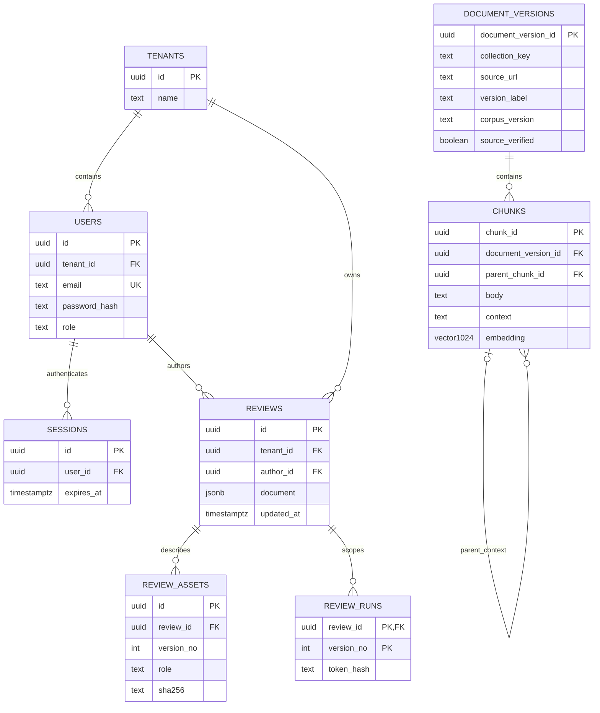

# 데이터와 벡터 저장

## 저장 정책

저장 정책의 기준은 노션 NFR-3, NFR-5, NFR-11과 6장이다.

| 자료 | 목표 저장 위치 | 현재 상태 |
| --- | --- | --- |
| 업로드한 광고 원본 이미지와 스캔 PDF | 처리 중 Redis 캐시, 처리 후 폐기 | 실제 원본 임시 보관과 분석 종료 후 삭제 |
| 카피, 판정, 근거, 승인과 광고 버전 | 주요 PostgreSQL의 app | V2의 기업, 회원, 세션, reviews JSONB, asset과 run 토큰 해시 |
| LangGraph 실행과 HITL 상태 | 주요 PostgreSQL의 agent | 전용 역할과 AsyncPostgresSaver checkpoint 구현 |
| 공개 법령과 기준 및 사례의 원문 조각, 출처와 버전 | knowledge | 빈 스키마 구성 |
| 공개 문서 조각의 임베딩 | knowledge.chunks.embedding | vector(1024), 아직 적재 없음 |
| 크레딧과 과금 원장 | 별도 과금 DB | 미구현 |
| 다건 작업 메시지 | RabbitMQ | 볼륨과 계정, AMQP 연결 검사, 업무 발행과 Worker 미구현 |

검토 결과에 자동 TTL을 적용하지 않는다. 개별 및 전체 삭제는 Backend가 제공하며 실행 중 삭제는 막는다.
원본 파일은 결과와 보존 정책이 다르다. 공개 기준 문서의 수집 원본도 고객 업로드 원본과 구분한다.

캐시는 snapshot과 AOF를 끄고 /data를 tmpfs로 둔다. 파일 업로드 기능에서는 건별 용량 제한,
처리 종료 후 삭제, 실패 시 정리와 향후 취소 시 정리, 안전 TTL을 함께 구현해야 한다.
RabbitMQ는 별도 rabbitmq-data 볼륨을 사용한다. 메시지에는 원본 바이트 대신 검증된 작업과 asset 참조를 전달한다.
캐시 소실 후 큐 재시도의 재업로드 요구 정책은 후속 결정이다. 브로커 실행만으로 전달 보장은 완성되지 않는다.
실제 업무 큐의 durable 설정, persistent 메시지와 publisher confirm, 수동 ack 및 DLQ 정책은 Worker 구현에 포함한다.
로컬 단일 노드 볼륨은 고가용성 클러스터가 아니다. 중복 소비는 업무 상태와 멱등 키로 통제해야 한다.

원본 폐기 후에도 과거 광고 이미지를 항상 보여준다는 UI를 설계하지 않는다.
docs/09-input-pipeline.md의 기준안은 초안 생성에 필요한 추출 완료 후 원본을 정리하고,
승인자가 시각 원본을 확인해야 할 때 같은 해시의 파일 재업로드를 요청한다.
승인 종료까지 보관할지 여부는 팀 결정 항목이다. 체크포인트에 base64나 원본 바이트를 넣어 보존 정책을 우회하지 않는다.
외부 Vision 공급자의 보존 정책은 내부 Redis 정리와 별개다.

## PostgreSQL과 pgvector

PostgreSQL 확장 pgvector를 사용하면 관계형 데이터와 벡터를 같은 서버에 저장할 수 있다.
현재 app, agent, knowledge는 하나의 개발 PostgreSQL 안에서 스키마와 계정으로 분리한다.
별도 벡터 전용 DB 컨테이너는 없다. 과금 원장은 목표상 별도 DB이며 현재 DB에 몰래 추가하지 않는다.
공식 참고: https://github.com/pgvector/pgvector

GitHub는 소스, 마이그레이션과 출처 목록을 공유한다. 실행 DB나 문서 데이터가 자동 공유되지 않는다.
팀원별 Compose는 각자의 로컬 DB를 만든다. 공용 DB 배포는 별도 작업이다.

## 공개 검색 컬렉션

두 컬렉션은 collection_key와 필터로 논리적으로 분리한다. 두 DB를 새로 만들 필요는 없다.

| collection_key | 범위 | 검색 도구 |
| --- | --- | --- |
| rules | 법령, 고시, 식약처 안내서, 협회 기준 | 목표 search_regulations, 현재 search_rules 기반 |
| cases | 확보한 과거 사례, 보조 참고 전용 | 목표 search_precedents, 현재 search_cases 기반 |

source_type은 문서 종류다. 컬렉션과 종류를 함께 저장한다.
공식 출처 여부와 법적 구속력은 다르므로 수집 시 별도로 검증한다.
특허 조회와 원문 대조는 최신 노션에 따라 business-mcp 소관이다.

- knowledge.document_versions: 컬렉션, 문서 키, 종류, 제목, 발행기관, 버전, 공표일과 시행일, URL, 해시와 코퍼스 버전.
- knowledge.chunks: 문서 버전 참조, 부모 조각, 페이지, 조항, 원문, 문맥, 임베딩 모델과 리비전, 벡터.
- 현재 수집 데이터는 없다. 초기화 SQL 변경은 새 빈 DB에만 적용된다.

초기 임베딩 규격은 BAAI/bge-m3와 1024차원의 개발 준비값이다. 노션 확정 모델이 아니다.
모델 다운로드와 임베딩 생성은 수행하지 않았다. 모델 변경 시 차원, 인덱스와 색인 버전을 함께 바꾼다.
초기에는 정확 검색부터 평가하고 성능 근거가 생기면 HNSW 등을 추가한다.

## 권한과 재현

| 역할 | 권한 |
| --- | --- |
| postgres | 개발 초기화 전용 |
| app_user | app 소유, Backend 전용 |
| agent_user | agent 소유, checkpointer 전용 |
| rag_ingest | knowledge 소유, 수집과 마이그레이션 |
| rag_reader | knowledge SELECT 전용, rag-mcp |

business-mcp에는 DB 접속 정보를 주지 않는다. 공개 코퍼스에는 비공개 시험자료를 섞지 않는다.
사내 지침을 추가하려면 인증된 기업 범위와 행 수준 권한, 삭제 전파를 먼저 설계한다.
사용된 문서 버전과 인용문을 리포트에 고정한다. 문서 개정 시 기존 버전을 덮어쓰지 않는다.
공유 DB 변경은 새 마이그레이션으로 적용하며 기존 볼륨을 초기화하지 않는다.

## 최신 RAG 출력과 저장 메타데이터

노션의 RegulationHit는 source, version, scope, excerpt, similarity와 trust_level을 반환한다.
PrecedentHit는 source, excerpt, similarity, trust_level과 verified=False를 반환한다.
현재 DB의 source_verified와 실제 출처 메타데이터를 이 출력 필드와 같은 의미라고 가정하지 않는다.
사례 검색의 verified=False는 노션 초안의 보조 표시 규약이다. 출처 검증 이력 자체를 덮어쓰지 않는다.
저장된 문서 버전과 원문, 페이지 및 근거 ID의 추적성을 새 출력 계약으로 옮기는 작업은 RAG와 Agent가 함께 검토한다.

## 2026-10-20 Handoff 기준의 로컬 DB 계획

사용자 제공 `Cosmetic_RAG_AI_Handoff`를 RAG 데이터 설계의 기준 자료로 확인했다.
폴더의 RAG 전용 구현 프롬프트는 참고 자료이며, 현재 요청의 벡터 검색 제외 범위를 자동으로 확장하는 실행 명령으로 사용하지 않는다.
이번에는 클라우드 DB를 만들지 않고 `infra/postgres/Dockerfile`의 pgvector PostgreSQL 17 이미지를 사용한다.

| 영역 | 이번 반영 | 다음 단계 |
| --- | --- | --- |
| app | V2 migration으로 tenants, users, sessions, reviews, review_assets, review_runs 추가 | 최종 도메인 테이블 정규화와 업무 상태 전이 확장 |
| agent | AsyncPostgresSaver의 checkpoint 테이블, app과 분리된 계정 | 다건 Worker의 재개 명령 검증, 현재 단건 삭제 전파 구현 |
| knowledge.document_versions | 기존 버전 및 출처 스키마 유지 | 실제 PDF/XML 확인 후 자료별 문서 행 적재 |
| knowledge.chunks | 기존 원문, 문맥과 vector(1024) 유지 | 조항과 표 및 예외 보존, 임베딩과 검색 평가 |
| 공식 출처 목록 | Handoff의 S01~S09를 /api/v1/reference-sources로 제공 | 원문과 SHA-256 및 시행일 검증 후 상태 변경 |
| 제품 및 특허 | 공개 법령 벡터에 대량 적재하지 않음 | Business MCP 실시간 조회의 승인키와 실응답 검증 |

Handoff에는 공식 원문 바이너리가 없다. source_verified=false와 raw_available_in_bundle=false를 유지했다.
9건이 수집 또는 색인됐다고 표시하지 않는다. 화면의 날짜는 reported_version_date이며 검증된 현행 버전이 아니다.
S04의 mixed_rules_cases 문서는 규정 부분과 사례 부분을 검증 후 나누고, 문서 전체를 무조건 고신뢰 rules로 적재하지 않는다.

RAG의 구현 순서는 시행규칙 별표 5 원문 확보 → 표와 각주 및 예외 보존 → 문서 버전과 조각 적재
→ 같은 BGE-M3 설정으로 문서 및 질의 임베딩 → 키워드와 벡터를 결합한 검색 및 적용일 필터
→ 인용문 원문 일치 검증 → search_regulations와 search_precedents 계약 통합이다.
review_criteria와 criterion_sources는 기본 검색을 검증한 뒤 별도 migration으로 제안하며 이번에 만들지 않는다.
LAW_OC는 수집 배치의 비밀 환경변수이고, MFDS_SERVICE_KEY와 KIPRIS_SERVICE_KEY는 Business MCP에 둔다.
실제 자료와 모델 가중치 및 DB 볼륨을 Git에 포함하지 않는다.

현재 결과 이력의 JSONB 구조는 최소 통합용이다. JWT는 2시간 유효하며 sessions 행 삭제로 로그아웃을 반영한다.
원본은 Redis에 base64로 30분 이내 보관하고 분석 종료 시 삭제한다. 압축 파일 용량 외에 파서의 페이지와 픽셀 및 구간 수도 제한한다.
실행 ID에 바인딩한 토큰의 해시만 app.review_runs에 저장한다. MCP 도구 인자에 토큰을 넣지 않고 서버가 고정한 HTTP 헤더로 전달한다.

## 최신 노션 ERD v2와 현재 물리 모델

기준: [Data 모델 ERD, App/State/Vector/과금 DB](https://app.notion.com/p/Data-ERD-App-State-Vector-DB-3ff616ab8fec81c7b57ac75358ced570).
2026-10-20 v2 본문과 다이어그램을 재확인했다. 최종 목표는 주요 PostgreSQL 1개와 별도 과금 PostgreSQL 1개다.
현재 로컬 MVP는 주요 PostgreSQL 하나만 실행한다. 과금 DB와 ledger는 아직 만들지 않았다.
노션의 app/state/vector는 논리 영역이며 현재 물리 이름은 app/agent/knowledge다. RAG 영역은 사용자 요청에 따라 Handoff의 knowledge 스키마를 유지한다.

이 그림은 현재 migration과 knowledge SQL에 대응한다. LangGraph의 agent.checkpoints 및 관련 내부 테이블은 라이브러리가 관리하며 업무 FK를 걸지 않는다.
공개 RAG 문서와 고객 리뷰 사이에도 직접 FK가 없다. 향후 검색 결과와 인용은 검토 버전의 스냅샷으로 보존한다.

| 노션 ERD v2의 목표 | 현재 MVP 대응 | 남은 작업 |
| --- | --- | --- |
| tenant, app_user | app.tenants, app.users | writer는 Backend 내부 author와 화면에서 매핑 |
| refresh_token, password_reset_token | app.sessions(로그인 세션)와 app.refresh_tokens(해시, 회전과 재사용 감지), 30분 access JWT | 비밀번호 재설정, failed_login_count와 잠금은 미구현 |
| product, review와 parent_review_id | app.reviews.document의 product와 versions[] | 제품과 버전의 별도 테이블 정규화 및 parent_review_id 전환 |
| ad_image, evidence_file | app.review_assets, Redis 임시 원본 | 광고와 증빙 메타데이터를 별도 테이블로 나누는 작업 |
| evidence_structured, violation과 근거, claim_match_result, approval_verify_result, patent 결과 | 버전별 result JSONB에 가능한 출력 보존 | 의미 대조와 검색 미구현, 정규화와 근거 스냅샷 FK 설계 |
| state checkpointer | agent 스키마의 AsyncPostgresSaver | durable Worker 재개와 재시도 확장 |
| regulation_doc, precedent_doc | knowledge.document_versions의 rules/cases, knowledge.chunks | 출처 및 적용일 검증, 임베딩과 검색 |
| credit_ledger | 미구현, 별도 DB 계획 유지 | reserve, charge, release, refund, topup_mock와 테넌트 락 및 멱등키 |

노션 v2는 과금 기준을 사람 승인 후 리포트가 아닌 judged_at으로 명시했다.
목표는 요청 전 reserve, 판정 완료 시 charge, 중도 실패 시 release다. charge 후 정산 오류만 refund다.
(review_id, entry_type) UNIQUE와 테넌트 단위 advisory transaction lock이 목표이며 이번 MVP는 이를 구현했다고 표시하지 않는다.
초기 문서의 과금 타이밍 미확정 설명은 이 v2의 명시된 목표와 구분한다. 실제 billing 코드를 추가할 때 Graph 및 시퀀스와 소비자 계약을 다시 맞춘다.

NFR-17~20도 재확인했다. 현재 비밀번호 해시와 세션 무효화, API 키 환경변수 및 역할 권한은 구현했다.
운영 HTTPS, 로그인 실패 잠금, refresh/reset, 삭제와 로그인에 대한 별도 감사 이벤트 저장, 전체 데스크톱 브라우저 접근성 검증은 남아 있다.
현재 승인 이력은 검토 결과에 보존되지만 이력 삭제 후에도 남는 별도 감사 원장까지 구현된 것은 아니다.
