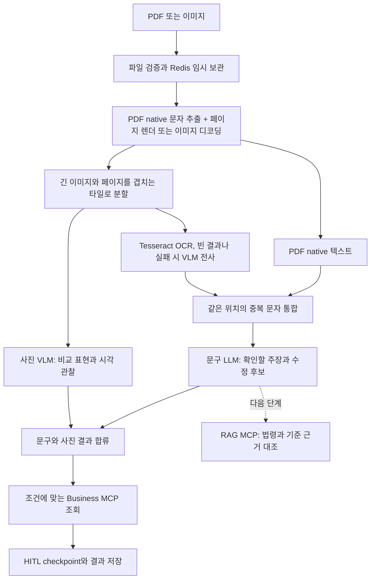

# 광고 입력과 두 분석 파이프라인

제품 입력은 PDF와 이미지 두 종류다. 텍스트, 스캔, 혼합 PDF와 긴 상세페이지는 서버 내부 처리 분기다.
직접 카피 입력은 제공하지 않는다. 광고와 증빙은 같은 형식이어도 asset role과 처리 책임이 다르다.

## 블록별 기술과 책임

| 블록 | 실행 위치 | 구현 기술 | 출력 |
| --- | --- | --- | --- |
| 사용자 파일 선택 | Vue | File API, multipart FormData | 실제 File과 제품 메타데이터 |
| 접수와 임시 보관 | Spring Boot | 파일 서명 검사, SHA-256, Redis TTL | 기업과 버전에 묶인 asset 참조 |
| PDF 문자 추출 | Agent | pdfplumber | native 텍스트, 페이지와 좌표 |
| PDF 페이지 렌더 | Agent | pypdfium2 | 페이지 이미지 |
| 이미지 해독과 분할 | Agent | Pillow, EXIF 회전 | 겹치는 타일과 원본 좌표 |
| 문구 읽기 | Agent 문구 노드 | Tesseract kor+eng, 실패 또는 빈 결과 시 OpenAI 전사 fallback | OCR 블록과 위치 출처 |
| 문구 예비검토 | Agent 문구 노드 | OpenAI Responses + Pydantic Structured Output | 원문에 존재하는 주장 후보와 확인 사유, 수정 제안 |
| 사진 독립 검토 | Agent 사진 노드 | OpenAI 이미지 입력, 별도 프롬프트와 모델 응답 Schema | 시각적 관찰, 우려와 비교 조건의 한계 |
| 증빙 읽기 | Business MCP | structure_evidence, 같은 순수 파서와 로컬 OCR | 증빙 원문과 실패 목록 |
| 근거 검색 | RAG MCP | 공개 문서 버전과 pgvector | legalize-kr 코퍼스는 연결됨, 나머지 출처는 적재 중 |

광고 파싱과 Vision은 Agent다. 증빙 처리만 Business MCP 도구다.
공통 파서 재사용을 위해 prepare_input이라는 새 필수 MCP를 만들지 않았다.
OpenAI 호출은 Agent에서 모델 공급자로 보내는 HTTPS이며 MCP 호출과 별개다.
키는 OPENAI_API_KEY 하나로 설정하고 TEXT_MODEL과 VISION_MODEL은 별도로 선택할 수 있다. 로컬 파서와 OCR에는 키가 없다.

## 실제 처리 순서

사진을 판단하기 위해 비슷한 사진을 Vector DB에서 찾는 구조가 아니다.
현재 사진 VLM은 광고 이미지 자체를 보고, 실제 효능이나 보정 여부를 확정하지 않는다.
RAG를 연결할 때도 문구의 법령 근거와 사진의 관찰은 별도 필드로 보존하고 최종 판단에서 필요한 경우 함께 참고한다.

## 긴 이미지 분리

구현 위치는 packages/shared/src/capstone_shared/documents.py다.
고정 높이로 자르지 않고, 상세페이지의 내용이 바뀌는 지점에서 구간을 나눈다(tile_image).
행마다 색 분산, 가로 경계 세기, 거친 색 분포를 구해 두 가지 경계를 찾는다.
하나는 빈 띠다. 띠 위아래의 배경색이 다르거나 이 페이지의 보통 줄 간격보다 확실히 길 때만 강한 경계로 본다.
같은 문단의 줄 사이 공백은 배경색과 높이가 비슷해 낮은 점수를 받는다.
다른 하나는 빈 띠 없이 사진이 색 블록과 만나는 지점이다. 바로 위와 아래 행 묶음의 색 분포가 크게 다르고,
양쪽이 한 묶음 더 바깥까지 같은 모습일 때만 경계로 본다. 글자 한 줄이나 막대 하나로는 경계가 되지 않는다.
구간 높이는 최소 max(320, 폭의 0.6배), 최대 max(1600, 폭의 1.5배)이고, 경계 점수에서 자를 때마다 비용을 뺀 합이
가장 큰 조합을 고른다. 약한 경계는 최대 높이를 넘길 때만 쓰고, 경계가 전혀 없으면 80px마다 가장 조용한 행에서 자른다.
구간은 겹치지 않고 맞닿는다. 원본 높이가 최대 높이 이하면 한 구간이다. PDF는 페이지마다 따로 나눈다.
각 구간은 원본 asset, 페이지, 원본 크기와 좌표를 가진다. 파일 전체를 작은 한 장으로 축소해 읽는 방식이 아니다.
원본 좌표를 보존한 뒤 VLM 전송용 구간 이미지만 최대 1600x1600으로 준비한다.
사진 경로가 구간마다 15자 이내의 이름(sectionTitle, 예: 임상 시험 결과)을 붙이고 result.tiles[].title로 저장한다.

예를 들어 높이 19,799px인 검증 상세페이지는 제품 소개, 기능성, 임상 수치, 성분 등 17개 구간으로 나뉜다.
문구는 같은 파일 및 페이지에서 세로 영역이 겹치고 공백 정규화 원문이 같은 경우만 중복 제거한다.
서로 떨어진 위치의 반복 주장은 별도 블록으로 남긴다. 잘린 문장과 표를 완벽하게 복원하는 레이아웃 모델은 아직 없다.

모든 타일은 사진 경로에도 전달한다. 글자가 없는 사진이라고 분석에서 빠지지 않는다.
비교 사진이 경계에서 잘리면 needsAdjacentContext와 인접 영역을 결과에 기록한다.
인접 타일을 합쳐 자동 재추론하는 기능은 아직 없으며 이 경우 담당자의 원본 확인이 필요하다.

## 좌표와 품질

- PDF native 문자와 Tesseract OCR은 엔진에서 얻은 좌표를 원본 기준 0~1로 환산한다.
- VLM 전사는 정확한 글자 위치를 만들지 않고 타일 영역만 반환한다. bbox=null, coordinateSource로 구분한다.
- 사진 결과도 관찰한 타일 영역이며 주름 한 줄의 정밀 검출 박스가 아니다.
- OCR confidence가 있는 경우 엔진 출력값으로만 기록한다. 모델 자신감이나 특허번호 후보의 정답 확률로 바꾸지 않는다.
- 모델이 추출한 phrase가 실제 원문 블록에 포함되지 않으면 결과에서 버린다.
- 모델에는 고객 문서 안의 명령을 실행하지 말라는 지침과 엄격한 응답 Schema를 적용한다.
- 작은 각주, 혼합 언어, 숫자와 도표의 정확도는 실제 광고 평가가 남아 있다. 형식 검증 통과가 내용 정확성을 보장하지 않는다.

## 한도와 예외

| 상황 | 현재 처리 |
| --- | --- |
| 광고 파일 없음 | 400, 광고 파일 필수 |
| 지원하지 않는 서명 | 415, PDF와 PNG, JPEG, WebP만 허용 |
| 파일 25 MiB 초과 또는 전체 75 MiB 초과 | 413 |
| 광고 5개 또는 증빙 10개 초과 | 접수 거부 |
| PDF 20페이지 초과, 이미지 또는 렌더 4천만 픽셀 초과, 광고 타일 총 40개 초과 | 파싱 실패, 새 원본 요청 |
| 손상되거나 암호화된 PDF | 분석 실패, 새 원본 요청 |
| 로컬 OCR 실패 | 설정된 OpenAI 전사 fallback, 없으면 경고 |
| 모델 키 없음 | text와 visual에 not_configured, 가짜 분석 결과 없음 |
| 모델 실패 | 해당 경로 partial과 경고, 다른 결과 보존 |
| 식약처 또는 KIPRIS 장애 | 해당 항목 error, 제품 부재나 위법으로 바꾸지 않음 |
| 미적재 출처 검색 | not_connected와 not_evaluated, 인용과 적합성 점수 없음(legalize-kr 코퍼스는 검색 연결됨) |
| 캐시 만료 또는 Redis 장애 | 실행 범위를 검사한 뒤 DB 원본으로 대체 조회. DB 원본도 없을 때만 410과 새 파일 제출 |
| 새 광고 버전 | 기존 승인을 복사하지 않고 새 pending |

Graph 실행은 270초 한도이며 OpenAI 요청은 50초와 SDK 제한 재시도를 사용한다.
긴 광고의 모든 타일을 처리하기에 부족하면 작업이 실패할 수 있다. 작업 분할과 노드별 복구는 후속이다.
이 MVP는 로컬 개발용이다. 파서 별도 프로세스 격리와 운영 자원 한도 및 부하 검증은 완료하지 않았다.

## 수명과 승인

파일 원본은 Backend의 Redis에만 저장하고 실행별 토큰으로 해당 리뷰 버전의 참조만 읽는다.
Agent와 Business MCP가 Redis를 직접 읽거나 사용자 URL을 임의로 fetch하지 않는다.
분석 종료 시 원본을 삭제하고 토큰의 해시와 파일 해시, 추출 텍스트 및 결과는 DB에 남긴다.
Graph에는 raw bytes, 이미지 base64와 실행 토큰을 저장하지 않는다.
증빙 원문(structure_evidence 결과의 전체 text와 문서별 documents[].text)은 business-mcp 호출 경계(mcp_call)에서 주민등록번호, 이메일, 휴대전화, 지역번호 전화번호를 가린다(guardrails.py). 가린 뒤의 원문만 business 도구 선택 루프의 모델 입력, 증빙 요약(evidence.py), 심각도 판정과 저장 결과에 쓰이고 가린 개수는 evidence.maskedPersonalData에 남는다.
특허번호, 보고번호, 날짜, 사업자등록번호와 대표번호는 대조에 쓰므로 그대로 둔다. 광고 문구는 원문 근거 매칭에 필요해 가리지 않는다.

같은 브라우저는 선택한 File을 메모리 미리보기로 보여줄 수 있다. 새로고침이나 다른 검토자에게 원본을 자동 전달하지 않는다.
이 MVP에는 같은 해시의 원본을 재연결해 열람하는 기능이 없다. 실제 원본 검토가 필요한 경우 보유 파일을 직접 확인해야 한다.
삭제는 app 이력뿐 아니라 해당 버전들의 Graph checkpoint도 제거한다.

OpenAI 요청의 store=false는 외부의 모든 데이터 보존이 없다는 보장이 아니다. 외부 데이터 정책은 내부 Redis 삭제와 별개다.
[OpenAI 이미지 입력](https://developers.openai.com/api/docs/guides/images-vision),
[Structured Outputs](https://developers.openai.com/api/docs/guides/structured-outputs),
[데이터 처리](https://developers.openai.com/api/docs/guides/your-data),
[LangGraph interrupt](https://docs.langchain.com/oss/python/langgraph/interrupts)를 참고한다.
